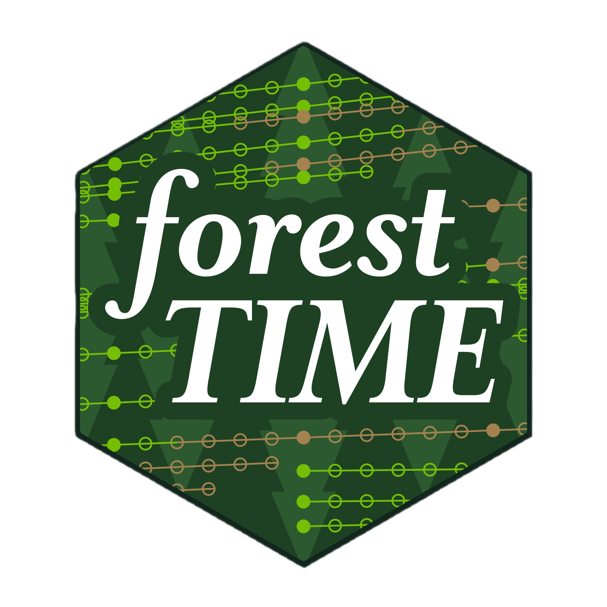

# forestTIME: Expanding longitudinal information from forest inventories 

> \[!CAUTION\] `forestTIME` is an **experimental** package and currently
> a **work-in-progress**. It is **not** an official product of the US
> Forest Service.

This R package contains functions to create annualized versions of FIA
data. It can download raw FIA data from DataMart, merge required tables,
interpolate between surveys, and re-estimate biomass and carbon from
interpolated values. The output is a single dataframe with values for
every tree in every year rather than the original panel design.

## Installation

`forestTIME` is not on CRAN.

To install from r-universe:

``` r

install.packages("forestTIME", repos = c("https://cct-datascience.r-universe.dev", getOption("repos")))
```

To install from GitHub:

``` r

#install.packages("pak")
pak::pak("Evans-Ecology-Lab/forestTIME")
```

## I just want the data!

If you just want to download annualized FIA tables produced by
`forestTIME.builder`, head over to the most recent
[release](https://doi.org/10.5281/zenodo.17088642) on Zenodo to download
parquet files. They can be read into R as dataframes with `nanoparquet`,
for example.

## Contributing

See
[CONTRIBUTING.md](https://evans-ecology-lab.github.io/forestTIME/CONTRIBUTING.md)

## Citation

To cite this work, please use:

> Scott E, Diaz R, Walker D, Steinberg D, Riemer K, Domke G, Walters B,
> Evans M (2025). “forestTIME: Generate Annualized Carbon and Biomass
> Estimates From FIA Data.” <https://doi.org/10.5281/zenodo.17088598>

Please also cite Westfall et al. (2024):

> Westfall, J.A., Coulston, J.W., Gray, A.N., Shaw, J.D., Radtke, P.J.,
> Walker, D.M., Weiskittel, A.R., MacFarlane, D.W., Affleck, D.L.R.,
> Zhao, D., Temesgen, H., Poudel, K.P., Frank, J.M., Prisley, S.P.,
> Wang, Y., Sánchez Meador, A.J., Auty, D., Domke, G.M., 2024. A
> national-scale tree volume, biomass, and carbon modeling system for
> the United States. U.S. Department of Agriculture, Forest Service.
> <https://doi.org/10.2737/wo-gtr-104>

------------------------------------------------------------------------

Developed in collaboration with the University of Arizona [CCT Data
Science](https://datascience.cct.arizona.edu/) team
